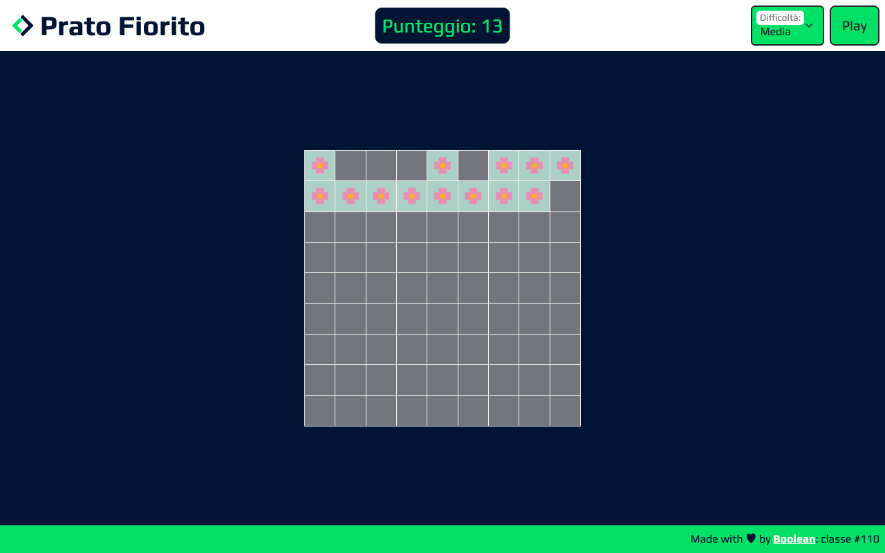

# Prato Fiorito

A grid game in plain JavaScript, built as an individual project during the Boolean programme in **November 2023**. The goal is to uncover safe cells while avoiding bombs: each safe cell increases the score, while a bomb ends the game.

**[Open the demo](https://massimoperuga.dev/en/demo/prato-fiorito)** · [Project in my portfolio](https://massimoperuga.dev/en/formazione/boolean#prato-fiorito) · [Italiano](README.md)

[](https://massimoperuga.dev/en/demo/prato-fiorito)

The [original assignment and exercise documentation](CONSEGNA.md), in Italian, is preserved in full, including the explanation of functions and bonus features.

## What it includes

- Three difficulty levels: grids of 100, 81 and 49 cells.
- Random generation of 16 bombs without duplicates.
- Scoring, victory and defeat messages, and revealing bombs after a loss.
- Stopping the game when a round ends and restarting with a reset score.

## My work

I developed the game logic and grid creation through the DOM. I split the code into functions for generating bombs, creating cells, handling clicks, scoring and ending a round.

## Stack and technical choices

| Area | Technologies |
| --- | --- |
| Logic and interactions | JavaScript, DOM APIs |
| Structure and layout | HTML, CSS, Bootstrap 5 |
| Typography and icons | Play, Font Awesome |

- **Functions with distinct responsibilities:** generation, reset and game updates are separated to make the game flow readable.
- **Explicit state:** `score` holds the score, while `gameOver` stops click handling once the round ends.
- **Grid creation:** cells are collected in a `DocumentFragment` and added to the DOM together.

Code entry points: [game logic](JS/main.js), [page](index.html) and [grid styles](CSS/_partials/main.css).

## Running locally

You need **Python 3**, a current browser and an Internet connection for Bootstrap, Google Fonts and Font Awesome loaded from CDNs.

```sh
git clone https://github.com/MassimoPeruga/js-campominato-dom.git
cd js-campominato-dom
python3 -m http.server 5180 --bind 127.0.0.1
```

Open [http://127.0.0.1:5180](http://127.0.0.1:5180), choose a difficulty level and press **Play**. No npm, build, database or credentials are required. Press `Ctrl+C` to stop the server.

Startup and game rules were checked with Python 3.14.0 and Chrome: all three grid sizes, unique bombs, safe-cell scoring, victory, defeat, stopping and restarting a round.

## Original project and portfolio demo

The original version uses a 400 × 400 px grid. The portfolio demo adds a responsive grid and keyboard controls, aligns bomb indices with cell indices and retains the selected difficulty throughout each round.

These changes live in the [portfolio adaptations](https://github.com/MassimoPeruga/portfolio/tree/production/site/demos), separately from this repository’s sources. The screenshot shows the original project; the interface retains its Italian text.
