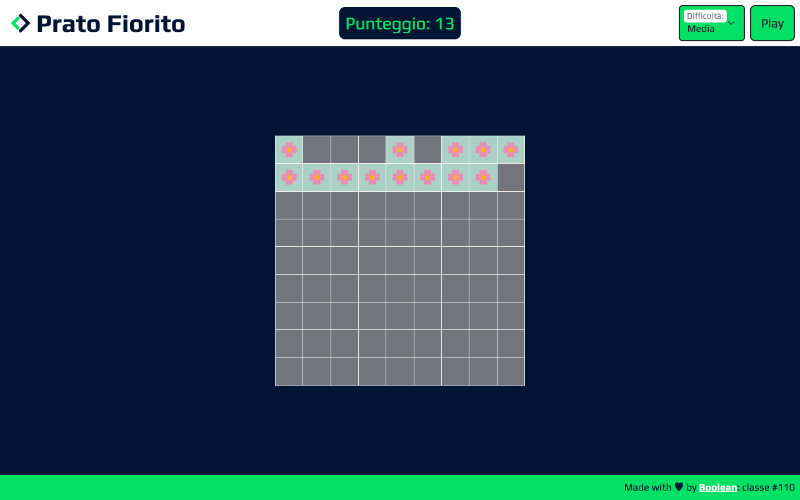

# Prato Fiorito

Gioco a griglia in JavaScript puro, realizzato come progetto individuale del percorso Boolean nel **novembre 2023**. L’obiettivo è scoprire le caselle sicure evitando le bombe: ogni casella sicura aumenta il punteggio, mentre una bomba termina la partita.

**[Apri la demo](https://massimoperuga.dev/demo/prato-fiorito)** · [Il progetto nel portfolio](https://massimoperuga.dev/formazione/boolean#prato-fiorito) · [English](README.en.md)

[](https://massimoperuga.dev/demo/prato-fiorito)

La [consegna e documentazione originale dell’esercizio](CONSEGNA.md) è conservata integralmente, inclusa la spiegazione delle funzioni e dei bonus.

## Cosa include

- Tre difficoltà: griglie da 100, 81 e 49 celle.
- Estrazione casuale di 16 bombe senza duplicati.
- Punteggio, messaggi di vittoria e sconfitta e visualizzazione delle bombe a fine partita persa.
- Arresto del gioco a fine partita e riavvio con azzeramento del punteggio.

## Il mio lavoro

Ho sviluppato la logica della partita e la creazione della griglia attraverso il DOM. Ho suddiviso il codice in funzioni dedicate a generazione delle bombe, creazione delle celle, gestione dei click, punteggio e fine partita.

## Stack e scelte tecniche

| Ambito | Tecnologie |
| --- | --- |
| Logica e interazioni | JavaScript, API DOM |
| Struttura e layout | HTML, CSS, Bootstrap 5 |
| Tipografia e icone | Play, Font Awesome |

- **Funzioni con compiti distinti:** generazione, reset e aggiornamento della partita sono separati per rendere leggibile il flusso del gioco.
- **Stato esplicito:** `score` conserva il punteggio e `gameOver` interrompe la gestione dei click dopo la fine della partita.
- **Creazione della griglia:** le celle vengono raccolte in un `DocumentFragment` e aggiunte insieme al DOM.

Punti d’ingresso: [logica del gioco](JS/main.js), [pagina](index.html) e [stili della griglia](CSS/_partials/main.css).

## Avvio locale

Servono **Python 3**, un browser aggiornato e una connessione Internet per Bootstrap, Google Fonts e Font Awesome caricati da CDN.

```sh
git clone https://github.com/MassimoPeruga/js-campominato-dom.git
cd js-campominato-dom
python3 -m http.server 5180 --bind 127.0.0.1
```

Apri [http://127.0.0.1:5180](http://127.0.0.1:5180), scegli la difficoltà e premi **Play**. Non sono necessari npm, build, database o credenziali. Per fermare il server premi `Ctrl+C`.

Avvio e regole di partita sono stati verificati con Python 3.14.0 e Chrome: tre dimensioni della griglia, bombe senza duplicati, conteggio delle celle sicure, vittoria, sconfitta, arresto e riavvio.

## Progetto originale e demo del portfolio

La versione originale usa una griglia di 400 × 400 px. La demo del portfolio aggiunge una griglia responsive e comandi da tastiera, allinea gli indici delle bombe a quelli delle celle e mantiene la difficoltà scelta per tutta la partita.

Questi interventi risiedono negli [adattamenti del portfolio](https://github.com/MassimoPeruga/portfolio/tree/production/site/demos), separati dai sorgenti di questa repository. Lo screenshot mostra il progetto originale; l’interfaccia mantiene i testi in italiano.
